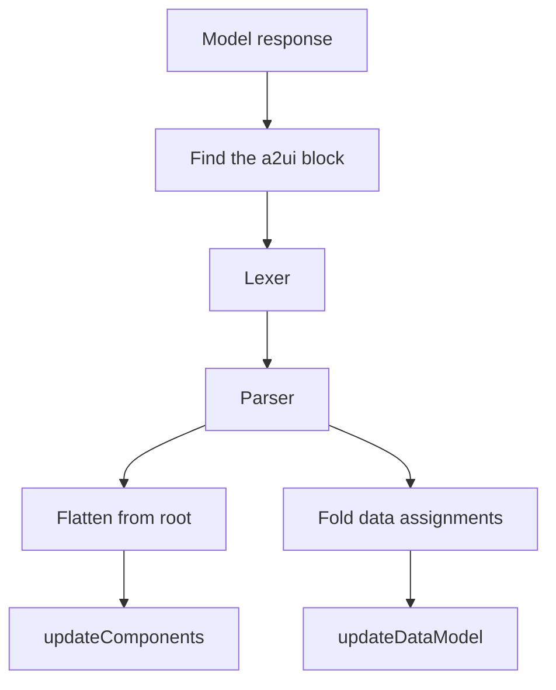

In [part one](/articles/how-a2ui-works), we looked at how [A2UI](https://a2ui.org/) lets a model describe UI as data, and why the format a renderer reads isn't necessarily the format a model should write. Now let's see what happens when the "agent" isn't a big model in the cloud but a small one running on a three-year-old phone.

Spoiler: the smallest model I tried couldn't write valid A2UI at all. So we'll write a tiny compiler in Kotlin that lets models speak a much more compact language instead, and then measure how much that actually helps.

> [!NOTE]
> Everything here was tested on November 13 and 14, 2026, on a Pixel 7 Pro, with [AndroidX A2UI Compose `1.0.0-alpha02`](https://developer.android.com/jetpack/androidx/releases/a2ui-compose), [LiteRT-LM `0.19.1`](https://github.com/google-ai-edge/LiteRT-LM/releases), Qwen3-0.6B and Gemma 4 E2B. The full sample lives in [`examples/a2ui-packing`](https://github.com/rafaeltonholo/portfolio/tree/main/examples/a2ui-packing). AndroidX A2UI is still in alpha, so expect some details to change.

## TL;DR

- Small models get A2UI's flat component list wrong. Qwen3-0.6B nested its components in three of five responses.
- A2UI's compact Express format is designed for on-device models, but there's no Kotlin compiler you can ship in an app. So I wrote a small one in Kotlin Multiplatform common code and benchmarked JSON against Express on a Pixel 7 Pro.
- Model size mattered more than format: Qwen3-0.6B produced 0 usable surfaces from JSON and 1 of 5 from Express, while Gemma 4 E2B handled both.
- Express still paid off with Gemma: a 37% shorter prompt, about a third faster to the first token, and checklists that showed every item the model generated. Its JSON surfaces often dropped items.

## A quick recap

If you've just read part one, skip this section. If not, here's what you need from it:

- An A2UI agent sends JSON messages. `updateComponents` describes the UI as a *flat* list: a `Column` doesn't contain its children, it lists their IDs, and one component must have the ID `root`. `updateDataModel` writes the data those components bind to.
- That JSON is the *wire format*, the one the renderer reads. The model can write something else, an *inference format*, and a compiler turns it into wire messages.
- A2UI Express is one of those formats. The model writes nested constructor calls with positional arguments, `$/path` binds to data, and `$/path = value` writes data:

```text
<a2ui>
$/items = [{name: "Towel", packed: false}, {name: "Sunscreen", packed: true}]
root = Column([title, item0, item1])
title = Text("Weekend packing list", "h2")
item0 = CheckBox($/items/0/name, $/items/0/packed)
item1 = CheckBox($/items/1/name, $/items/1/packed)
</a2ui>
```

The Express compilers live in A2UI's agent SDKs for TypeScript, Python and Dart[^sdks], and there's no Kotlin one you can ship in an app. When the model runs *on the phone*, the compiler has to run on the phone too.

## Picking the model

Before writing a compiler, we need a model. The easiest option on Android is Gemini Nano through the [ML Kit Prompt API](https://developer.android.com/ai/gemini-nano): the system manages the model, and you don't ship anything[^nano]. I tried it on my Pixel 7 Pro, and:

```text
status=UNAVAILABLE
```

Gemini Nano is only offered on [a list of recent devices](https://developers.google.com/ml-kit/genai), and the AICore installed on this phone is just a stub. That's the trade-off worth knowing about: the system model is the smoothest path where it exists, but if you want to reach older devices, you have to bring your own model.

That's what [LiteRT-LM](https://github.com/google-ai-edge/LiteRT-LM/blob/main/docs/api/kotlin/getting_started.md) is for. You give it a `.litertlm` model file and it runs it with a Kotlin API. I used two models from the LiteRT community on Hugging Face:

- [Qwen3-0.6B](https://huggingface.co/litert-community/Qwen3-0.6B), about 600 MB, a really small model
- [Gemma 4 E2B](https://huggingface.co/litert-community/gemma-4-E2B-it-litert-lm), about 2.6 GB, the size the Express spec was designed for[^express]

You may have seen that [LiteRT now ships in Google Play services](https://developers.googleblog.com/smaller-apps-and-faster-gpu-inference-with-litert-in-google-play-services/), so apps no longer need to bundle their own ML runtime[^litert]. That announcement covers LiteRT for custom `.tflite` models. Running a language model still goes through the LiteRT-LM library, which the sample adds as a regular dependency.

## First attempt: let the model write JSON

I started the obvious way: describe the protocol in the prompt, give one example of the two messages, and ask the model for a checklist. Here's what Qwen3-0.6B sent back when I asked it to pack for a beach trip (trimmed):

```json
{
  "updateComponents": {
    "surfaceId": "packing",
    "components": [
      {
        "id": "root",
        "component": "Column",
        "children": [
          {
            "id": "title",
            "component": "Text",
            "text": "Board game night",
            "variant": "h2"
          },
          ...
```

See the problem? Well, two of them. The title is copied straight from the prompt's example, but the bigger one is `children`: it should be a list of IDs, and the model put the components *inside* it. Three of the five requests came back nested like this, even though the prompt literally showed a flat list. The other two were flat, but forgot the `updateDataModel` message, so every checkbox pointed at data that didn't exist.

This is the question part one left open: the flat list is great for renderers, but is it a good format for a model to write? For a small one, clearly not. Which is exactly the job of an inference format: let the model write the tree, and let a compiler flatten it.

## Writing an Express compiler in Kotlin

I didn't need all of Express to test the idea. The sample supports a subset: assignments, inline nesting, positional and keyword arguments, `_` to skip an optional argument, strings, numbers, booleans, lists, maps, `$/path` bindings, data assignments and `Event(...)` actions. Templates, validation checks, functions and multiple catalogs are left out.

It lives in its own module, [`express`](https://github.com/rafaeltonholo/portfolio/tree/main/examples/a2ui-packing/express), and everything is in `commonMain` with no platform code. It compiles for Android and the JVM, and the tests run on the JVM.

The pipeline is a classic one:



Using it looks like this:

```kotlin
val catalog = ExpressCatalog.fromSchema(catalogJson)
val compiler = ExpressCompiler(catalog)

val messages: List<JsonObject> = compiler.compile(response = modelOutput, surfaceId = "packing")
messages.forEach { processor.processInput(parser, it.toString()) }
```

A few decisions worth pointing out.

### One source for the signatures

Since arguments are positional, the compiler has to know that `CheckBox` takes `label` and then `value`. That order comes from the catalog's JSON schema, and the prompt needs the very same list. If those two ever disagree, the model writes arguments in one order and the compiler reads them in another.

So `ExpressCatalog` reads the schema once, and both sides use it. The prompt gets its signatures from the catalog:

```kotlin
catalog.promptSignatures(listOf("Column", "Text", "CheckBox"))
```

```text
Column(children, justify?, align?)
Text(text, variant?: h1|h2|h3|h4|h5|caption|body)
CheckBox(label, value)
```

I checked the property names for these components in the AndroidX catalog classes, and they match the published v0.9 schema, whose order the compiler follows.

### Flattening

The flattener walks the tree from `root`. A component assigned to a variable keeps the variable name as its ID, and an inline component gets an ID made from its parent and the slot it fills. So in:

```text
root = Card(Column([Text($/flight/number)]))
```

the `Column` becomes `root_child` and the `Text` becomes `root_child_children_0`. That's the same naming the reference compilers use, which let me test against the example in the A2UI docs: the compiler has to produce exactly the messages the docs show.

### Errors a model can act on

When something's wrong, the compiler throws an `ExpressException` with the line and a short reason, such as `Line 2: Chart is not in the catalog` or `Line 1: CheckBox is missing value`. Short reasons matter, because the A2UI loop is to send the error back to the model and ask it to fix that line.

### A renderer race

My first device run rendered the title but left the checkboxes as grey placeholders, and they never filled in. The compiler was sending `updateComponents` before `updateDataModel`, which the protocol allows, so I swapped the order, the placeholders went away, and I moved on thinking the renderer ignored data that arrived after its components.

Ok, but was the order really the problem? When I came back to record it for this article, I couldn't make it happen on demand, so I tested it properly. The [probe](https://github.com/rafaeltonholo/portfolio/blob/main/examples/a2ui-packing/app/src/androidTest/kotlin/dev/tonholo/a2uipacking/RendererRaceProbe.kt) sends the same recorded checklist to AndroidX A2UI `1.0.0-alpha02` in both orders, with and without a one-second pause between the messages. It collects messages either on a background thread, the way the [official guide](https://developer.android.com/develop/ui/compose/agentic/render-surfaces) does[^render], or on the main thread:

| Collector | Order | Pause | Stuck on placeholders |
| --- | --- | --- | --- |
| Background | components, then data | none | 4 of 32 runs |
| Background | data, then components | none | 0 of 13 runs |
| Main | components, then data | none | 0 of 13 runs |
| Either | either | 1 s | 0 of 20 runs |

Every run is in [`renderer-race.txt`](https://github.com/rafaeltonholo/portfolio/blob/main/examples/a2ui-packing/benchmark-results/renderer-race.txt). Figure 1 is a real failing run, and Figure 2 is the same checklist with the data sent first.

{{{ .components.molecules.ArticleFigureRow


}}}

So my first explanation was wrong. The renderer does pick up data that arrives later: with a pause between the messages, it rendered every time. What I hit is an intermittent race, about one run in eight, and I only saw it with the collector on a background thread and the data landing right after the components. Don't read the zeros as proof, though: at one in eight, 13 clean runs can still be luck, so I can't rule it out in the other cells. I haven't found the root cause, and it's an alpha, so it may be gone by the time you read this. The compiler still sends the data first, which avoided it in every run I did, and the protocol is fine with that order.

## What happened on the Pixel

Time to put it to the test. The [benchmark](https://github.com/rafaeltonholo/portfolio/blob/main/examples/a2ui-packing/app/src/androidTest/kotlin/dev/tonholo/a2uipacking/FormatBenchmarkTest.kt) asks each model for the same five checklists, a beach trip, a rainy hike, a ski weekend, a business trip and a picnic, once as JSON and once as Express. Both prompts describe the same UI and use the same example. Every response goes through a structural check: a flat list with a `root`, children that exist, only `Column`, `Text` and `CheckBox`, and bindings that point at real data. Everything ran on the Pixel's CPU, and the raw results are in [`benchmark-results`](https://github.com/rafaeltonholo/portfolio/tree/main/examples/a2ui-packing/benchmark-results).

> [!NOTE]
> I ran each request twice, but at a temperature of 0.2 both runs came out identical, so think of this as five requests per cell. That's enough to see big differences, not small ones.

### Did it produce a surface?

| Model | JSON | Express |
| --- | --- | --- |
| Qwen3-0.6B | 0 of 5 | 2 of 5 (1 usable) |
| Gemma 4 E2B | 5 of 5 | 4 of 5 |

Qwen couldn't write JSON at all, and Express only partly helped. One of its two passing responses was just a title with no checkboxes, which is valid A2UI but not much of a packing list. The failures were all real mistakes, not compiler gaps: once it wrote XML inside the `<a2ui>` block, and twice it wrote an empty `Column()`, one of them after a stray `$` that broke the line before it.

Gemma was a different story: it wrote valid JSON every time. One detail, though: it followed the prompt to the letter, which meant components first and data second, the order that occasionally tripped the renderer race from earlier, and no `createSurface`, because the prompt didn't ask for one. Either way, the app would have to fix up those messages before showing them. Its one Express failure was the ski weekend, where it got stuck repeating `"Ski Socks (extra)"` until it hit the 512-token limit.

So the honest first conclusion is that model size mattered more than format. At 0.6B parameters, getting the format right left nothing for the actual task.

### What did the surface show?

Passing the check doesn't mean the checklist is any good, though. Here's what Gemma generated for each request, as items in the data model versus checkboxes on screen:

| Format | Beach | Hike | Ski | Business | Picnic |
| --- | --- | --- | --- | --- | --- |
| JSON | 3 / 3 | 6 / 2 | 6 / 3 | 5 / 2 | 3 / 2 |
| Express | 6 / 6 | 7 / 6 | looped | 7 / 7 | 5 / 5 |

With JSON, Gemma usually filled the data model with five or six items but only wrote two or three checkboxes, the same number as the prompt's example. The rest of the items were there, but nothing on screen showed them. With Express, the checkboxes matched the items in all but one case. My guess is that writing `item3 = CheckBox(...)` one line at a time is easier to keep going than a long JSON array of near-identical objects, but I only have five samples, so take that as a hypothesis.

Here's the business trip from the benchmark, rendered in the app from the saved responses. Figure 3 is the JSON response: five items in the data model, two checkboxes on screen. Figure 4 is the Express response: seven and seven. For the JSON side, I added the `createSurface` that the JSON prompt doesn't ask for, and nothing else changed.

{{{ .components.molecules.ArticleFigureRow


}}}

### How long did it take?

| Model | Prompt | Time to first token | Total, valid runs only |
| --- | :---: | :---: | --- |
| Gemma 4 E2B, JSON | 1,112 characters | 4.6 s | 33 s for a median of 5 items |
| Gemma 4 E2B, Express | 704 characters | 3.0 s | 37 s for a median of 6.5 items |

The Express prompt is 37% shorter, and the first token arrived about a third sooner, consistent with less prompt to read. Qwen showed the same drop, from 9.9 s to 6.7 s. Generation speed itself didn't change with the format.

What about output tokens? The A2UI project's own benchmark, run on Gemini Flash, measured 63% fewer of them with Express than with wire JSON[^formats]. I didn't see that here. Per checklist item, Gemma spent about 42 output tokens with JSON and 41 with Express. That's less surprising than it sounds: the prompt's example gives every checkbox its own variable, which is Express at its least compact, and the item names make up a big part of the output in both formats. Templates, which let a single line repeat a component for every item in a list, would probably change that, but the sample doesn't support them yet. LiteRT-LM reports output token counts, and those are the only token numbers I used.

I didn't compare the two models' speed with each other. Qwen generated about 4 tokens per second and Gemma about 7.5, even though Qwen is much smaller, and I haven't figured out why.

### And in the app

Finally, the real thing: Gemma 4 E2B, the compiler and the AndroidX renderer in the sample app, with the request "Pack for a rainy weekend in Halifax". It produced a title and five checkboxes (raincoat, warm socks, a cozy blanket, books and hot cocoa, which honestly sounds like a good weekend), and ticking one updated the local data model right away. I ran it three times while testing and got the same five items every time, and the two runs I timed took 34 and 30 seconds. Figure 5 is a recording of one run.

{{{ .components.molecules.ArticleVideo(src = "/images/articles/on-device-llm-a2ui-android/packing-app-run.mp4", poster = "/images/articles/on-device-llm-a2ui-android/packing-app-run-poster.png", caption = "Figure 5. Gemma 4 E2B on a Pixel 7 Pro. The 30 seconds of generation are sped up six times; the counter on the card shows the real time.") }}}

## Handling user actions

The sample stops at rendering, so this part is design guidance rather than tested code. The compiler already turns `Event("done", {items: $/items})` into an action, but I haven't run the round trip on the device.

When the app receives an action, it should:

1. Check that the event name is one the app expects.
2. Validate the values and decide which ones the next turn needs.
3. Either handle a known action in app code or send a bounded description of it to the model.
4. Compile and process the model's next response for the right surface.

Don't let the model choose arbitrary app operations just because an event name showed up in generated data. A button labelled "Book trip" is still only a request, and the app decides what it's allowed to do and when the user has to confirm it.

## And Kotlin Multiplatform?

The compiler is the part that was easiest to share: it's pure Kotlin in `commonMain`, with kotlinx.serialization as its only dependency. The prompts, the validation and the conversation state could live there too.

What doesn't come along for free is the rest. The AndroidX renderer is Android only, though there's a [community KMP port](https://github.com/BinaryTape/a2ui-kmp) worth checking. LiteRT-LM documents a Kotlin API for Android and the JVM and a separate Swift API in early preview, so an iOS target would need its own inference integration.

## A few things worth testing

Before shipping something like this, test the whole loop on the devices and models you intend to support:

- Recorded responses, both valid and broken: nested components, unknown components, missing arguments, truncated output.
- Bound data, not just literal text, in the renderer you actually ship.
- Messages that arrive over time, not all at once. A model streams, so test with pauses between messages, and on a real clock: inside a Compose test, `delay()` runs on a virtual clock, and my first version of the race test never sent its second message at all.
- Model download, storage, cancellation and app backgrounding.
- Time to first useful UI, memory and battery across representative devices.
- Accessibility, focus and readable fallback states for the generated UI.

Model output is variable, so one good run proves very little. Keep a set of requests and recorded responses, and run them again whenever the prompt, model, catalog or renderer changes.

## Conclusion

A2UI's core idea is simple: the app owns a catalog of components, and the agent describes UI as data, never code. The flat component list and the separate data model make a lot of sense for streaming renderers, and the spec is refreshingly honest that models will get things wrong and need validation.

What surprised me is how much the *inference format* matters once the model runs on the phone. A 0.6B model couldn't write the wire format at all. A 2B-class model could, but it still built better checklists, and started faster, when it wrote Express and let a compiler do the flattening. And because that compiler is a few hundred lines of plain Kotlin in `commonMain`, it can live right next to the model, on Android today and anywhere Kotlin runs later.

If you try this yourself, the whole sample is on GitHub in [`examples/a2ui-packing`](https://github.com/rafaeltonholo/portfolio/tree/main/examples/a2ui-packing): the Express compiler, the app, the benchmark and the race probe. Start with a recorded response and the real renderer, then add the model and measure on the devices you care about. Five requests on one phone taught me more than any amount of reading the docs.

Thanks for reading this far! I hope this gives you a starting point for experimenting with on-device AI and A2UI.

## Sources

[^sdks]: A2UI SDKs, https://a2ui.org/concepts/sdks/

[^nano]: Gemini Nano on Android, https://developer.android.com/ai/gemini-nano

[^express]: A2UI Express proposal, https://github.com/a2ui-project/a2ui/blob/main/specification/proposals/express/a2ui_express.md

[^litert]: Smaller apps and faster GPU inference with LiteRT in Google Play services, https://developers.googleblog.com/smaller-apps-and-faster-gpu-inference-with-litert-in-google-play-services/

[^render]: Render A2UI surfaces in your app, https://developer.android.com/develop/ui/compose/agentic/render-surfaces

[^formats]: A2UI inference formats, https://a2ui.org/concepts/inference-formats/
