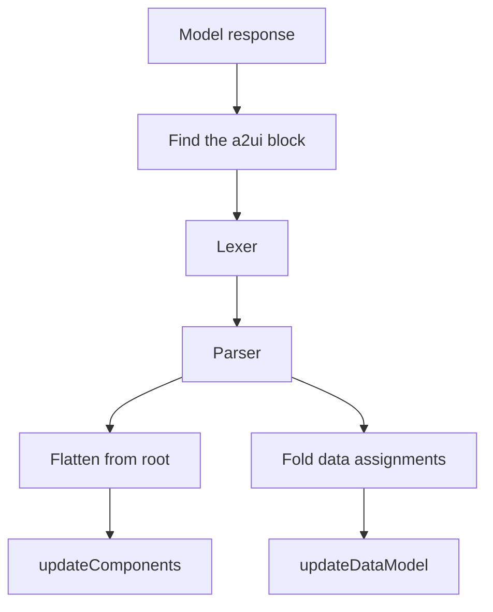

Na [parte um](/articles/pt-br/how-a2ui-works), vimos como o [A2UI](https://a2ui.org/) deixa um modelo descrever a UI como dados, e por que o formato que um renderer lê não é necessariamente o formato que um modelo deveria escrever. Agora vamos ver o que acontece quando o "agente" não é um modelo gigante na nuvem, mas um pequeno rodando num celular de três anos atrás.

Spoiler: o menor modelo que eu testei não conseguiu escrever um A2UI válido nem uma vez. Então vamos escrever um compilador minúsculo em Kotlin que deixa os modelos falarem uma linguagem bem mais compacta, e depois medir o quanto isso ajuda de verdade.

> [!NOTE]
> Tudo aqui foi testado nos dias 13 e 14 de novembro de 2026, num Pixel 7 Pro, com [AndroidX A2UI Compose `1.0.0-alpha02`](https://developer.android.com/jetpack/androidx/releases/a2ui-compose), [LiteRT-LM `0.19.1`](https://github.com/google-ai-edge/LiteRT-LM/releases), Qwen3-0.6B e Gemma 4 E2B. O sample completo está em [`examples/a2ui-packing`](https://github.com/rafaeltonholo/portfolio/tree/main/examples/a2ui-packing). O AndroidX A2UI ainda está em alpha, então espere que alguns detalhes mudem.

## TL;DR

- Modelos pequenos erram a lista plana de componentes do A2UI. O Qwen3-0.6B aninhou os componentes em três de cinco respostas.
- O formato compacto do A2UI, o Express, foi feito pra modelos on-device, mas não existe um compilador em Kotlin que você possa colocar num app. Então eu escrevi um pequeno em código comum do Kotlin Multiplatform e comparei JSON contra Express num Pixel 7 Pro.
- O tamanho do modelo importou mais que o formato: o Qwen3-0.6B produziu 0 surfaces usáveis com JSON e 1 de 5 com Express, enquanto o Gemma 4 E2B se virou bem com os dois.
- Mesmo assim o Express valeu a pena com o Gemma: um prompt 37% menor, o primeiro token cerca de um terço mais rápido, e checklists que mostravam todos os itens que o modelo gerou. As surfaces em JSON muitas vezes perdiam itens.

## Uma recapitulação rápida

Se você acabou de ler a parte um, pode pular essa seção. Se não, aqui vai o que você precisa dela:

- Um agente A2UI manda mensagens JSON. O `updateComponents` descreve a UI como uma lista *plana*: um `Column` não contém os filhos, ele lista os IDs deles, e um componente precisa ter o ID `root`. O `updateDataModel` escreve os dados aos quais esses componentes fazem bind.
- Esse JSON é o *wire format*, o que o renderer lê. O modelo pode escrever outra coisa, um *inference format*, e um compilador transforma isso em mensagens do wire.
- O A2UI Express é um desses formatos. O modelo escreve chamadas de construtor aninhadas com argumentos posicionais, `$/path` faz bind com dados, e `$/path = value` escreve dados:

```text
<a2ui>
$/items = [{name: "Towel", packed: false}, {name: "Sunscreen", packed: true}]
root = Column([title, item0, item1])
title = Text("Weekend packing list", "h2")
item0 = CheckBox($/items/0/name, $/items/0/packed)
item1 = CheckBox($/items/1/name, $/items/1/packed)
</a2ui>
```

Os compiladores do Express vivem nos SDKs de agente do A2UI pra TypeScript, Python e Dart[^sdks], e não existe um em Kotlin que você possa colocar num app. Quando o modelo roda *no celular*, o compilador também precisa rodar no celular.

## Escolhendo o modelo

Antes de escrever um compilador, a gente precisa de um modelo. A opção mais fácil no Android é o Gemini Nano, pela [Prompt API do ML Kit](https://developer.android.com/ai/gemini-nano): o sistema gerencia o modelo e você não entrega nada junto com o app[^nano]. Eu testei no meu Pixel 7 Pro e:

```text
status=UNAVAILABLE
```

O Gemini Nano só é oferecido numa [lista de aparelhos recentes](https://developers.google.com/ml-kit/genai), e o AICore instalado nesse celular é só um stub. Esse é o trade-off que vale conhecer: o modelo do sistema é o caminho mais tranquilo onde ele existe, mas se você quer alcançar aparelhos mais antigos, precisa levar o seu próprio modelo.

É pra isso que serve o [LiteRT-LM](https://github.com/google-ai-edge/LiteRT-LM/blob/main/docs/api/kotlin/getting_started.md). Você dá um arquivo de modelo `.litertlm` pra ele e ele roda com uma API em Kotlin. Eu usei dois modelos da comunidade LiteRT no Hugging Face:

- [Qwen3-0.6B](https://huggingface.co/litert-community/Qwen3-0.6B), uns 600 MB, um modelo bem pequeno
- [Gemma 4 E2B](https://huggingface.co/litert-community/gemma-4-E2B-it-litert-lm), uns 2,6 GB, o tamanho pra qual a especificação do Express foi pensada[^express]

Você deve ter visto que o [LiteRT agora vem nos Google Play services](https://developers.googleblog.com/smaller-apps-and-faster-gpu-inference-with-litert-in-google-play-services/), então os apps não precisam mais embarcar o próprio runtime de ML[^litert]. Esse anúncio cobre o LiteRT pra modelos `.tflite` customizados. Rodar um modelo de linguagem ainda passa pela biblioteca LiteRT-LM, que o sample adiciona como uma dependência normal.

## Primeira tentativa: deixar o modelo escrever JSON

Comecei do jeito óbvio: descrevi o protocolo no prompt, dei um exemplo das duas mensagens e pedi um checklist pro modelo. Olha o que o Qwen3-0.6B devolveu quando pedi pra ele montar a mala de uma viagem de praia (resumido):

```json
{
  "updateComponents": {
    "surfaceId": "packing",
    "components": [
      {
        "id": "root",
        "component": "Column",
        "children": [
          {
            "id": "title",
            "component": "Text",
            "text": "Board game night",
            "variant": "h2"
          },
          ...
```

Viu o problema? Bom, dois. O título foi copiado direto do exemplo do prompt, mas o maior é o `children`: ele devia ser uma lista de IDs, e o modelo colocou os componentes *dentro* dele. Três das cinco requisições voltaram aninhadas assim, mesmo o prompt mostrando literalmente uma lista plana. As outras duas vieram planas, mas esqueceram a mensagem `updateDataModel`, então todo checkbox apontava pra um dado que não existia.

Essa é a pergunta que a parte um deixou em aberto: a lista plana é ótima pra renderers, mas é um bom formato pra um modelo escrever? Pra um modelo pequeno, claramente não. E é exatamente esse o trabalho de um inference format: deixar o modelo escrever a árvore e deixar um compilador achatar ela.

## Escrevendo um compilador Express em Kotlin

Eu não precisava do Express inteiro pra testar a ideia. O sample suporta um subconjunto: atribuições, aninhamento inline, argumentos posicionais e nomeados, `_` pra pular um argumento opcional, strings, números, booleanos, listas, maps, bindings `$/path`, atribuições de dados e actions `Event(...)`. Templates, checks de validação, funções e múltiplos catálogos ficaram de fora.

Ele vive no próprio módulo, o [`express`](https://github.com/rafaeltonholo/portfolio/tree/main/examples/a2ui-packing/express), e tudo está no `commonMain`, sem código de plataforma. Ele compila pra Android e JVM, e os testes rodam na JVM.

O pipeline é um clássico:



Usar ele fica assim:

```kotlin
val catalog = ExpressCatalog.fromSchema(catalogJson)
val compiler = ExpressCompiler(catalog)

val messages: List<JsonObject> = compiler.compile(response = modelOutput, surfaceId = "packing")
messages.forEach { processor.processInput(parser, it.toString()) }
```

Algumas decisões que valem ser destacadas.

### Uma fonte só pras assinaturas

Como os argumentos são posicionais, o compilador precisa saber que o `CheckBox` recebe `label` e depois `value`. Essa ordem vem do JSON schema do catálogo, e o prompt precisa da mesma lista. Se essas duas coisas um dia discordarem, o modelo escreve os argumentos numa ordem e o compilador lê em outra.

Então o `ExpressCatalog` lê o schema uma vez só, e os dois lados usam ele. O prompt pega as assinaturas do catálogo:

```kotlin
catalog.promptSignatures(listOf("Column", "Text", "CheckBox"))
```

```text
Column(children, justify?, align?)
Text(text, variant?: h1|h2|h3|h4|h5|caption|body)
CheckBox(label, value)
```

Eu conferi os nomes das propriedades desses componentes nas classes do catálogo do AndroidX, e elas batem com o schema v0.9 publicado, cuja ordem o compilador segue.

### Achatando a árvore

O flattener anda pela árvore a partir do `root`. Um componente atribuído a uma variável mantém o nome da variável como ID, e um componente inline ganha um ID feito do pai com o slot que ele ocupa. Então em:

```text
root = Card(Column([Text($/flight/number)]))
```

o `Column` vira `root_child` e o `Text` vira `root_child_children_0`. É a mesma nomenclatura dos compiladores de referência, o que me deixou testar contra o exemplo da documentação do A2UI: o compilador precisa produzir exatamente as mensagens que a documentação mostra.

### Erros que um modelo consegue usar

Quando algo está errado, o compilador joga uma `ExpressException` com a linha e um motivo curto, tipo `Line 2: Chart is not in the catalog` ou `Line 1: CheckBox is missing value`. Motivos curtos importam, porque o ciclo do A2UI é mandar o erro de volta pro modelo e pedir pra ele consertar aquela linha.

### Uma race no renderer

Minha primeira execução no aparelho renderizou o título mas deixou os checkboxes como placeholders cinzas, e eles nunca preencheram. O compilador estava mandando o `updateComponents` antes do `updateDataModel`, o que o protocolo permite, então eu troquei a ordem, os placeholders sumiram, e eu segui em frente achando que o renderer ignorava dados que chegavam depois dos componentes.

Ok, mas será que a ordem era mesmo o problema? Quando voltei pra gravar isso pra esse artigo, não consegui fazer acontecer de novo quando eu queria, então testei direito. O [probe](https://github.com/rafaeltonholo/portfolio/blob/main/examples/a2ui-packing/app/src/androidTest/kotlin/dev/tonholo/a2uipacking/RendererRaceProbe.kt) manda o mesmo checklist gravado pro AndroidX A2UI `1.0.0-alpha02` nas duas ordens, com e sem uma pausa de um segundo entre as mensagens. Ele coleta as mensagens ou numa thread de background, do jeito que o [guia oficial](https://developer.android.com/develop/ui/compose/agentic/render-surfaces) faz[^render], ou na main thread:

| Collector | Ordem | Pausa | Travou nos placeholders |
| --- | --- | --- | --- |
| Background | componentes, depois dados | nenhuma | 4 de 32 execuções |
| Background | dados, depois componentes | nenhuma | 0 de 13 execuções |
| Main | componentes, depois dados | nenhuma | 0 de 13 execuções |
| Qualquer | qualquer | 1 s | 0 de 20 execuções |

Todas as execuções estão em [`renderer-race.txt`](https://github.com/rafaeltonholo/portfolio/blob/main/examples/a2ui-packing/benchmark-results/renderer-race.txt). A Figura 1 é uma execução real que falhou, e a Figura 2 é o mesmo checklist com os dados enviados primeiro.

{{{ .components.molecules.ArticleFigureRow


}}}

Então a minha primeira explicação estava errada. O renderer pega sim dados que chegam depois: com uma pausa entre as mensagens, ele renderizou todas as vezes. O que eu encontrei é uma race intermitente, uma execução em cada oito, e eu só vi com o collector numa thread de background e os dados chegando logo depois dos componentes. Mas não leia os zeros como prova: com uma chance de um em oito, 13 execuções limpas ainda podem ser sorte, então eu não consigo descartar isso nas outras células. Eu não achei a causa raiz, e é um alpha, então ela pode já ter sumido quando você ler isso. O compilador continua mandando os dados primeiro, o que evitou o problema em todas as execuções que eu fiz, e o protocolo aceita essa ordem sem problema.

## O que aconteceu no Pixel

Hora de colocar à prova. O [benchmark](https://github.com/rafaeltonholo/portfolio/blob/main/examples/a2ui-packing/app/src/androidTest/kotlin/dev/tonholo/a2uipacking/FormatBenchmarkTest.kt) pede pra cada modelo os mesmos cinco checklists, uma viagem de praia, uma trilha na chuva, um fim de semana de esqui, uma viagem de negócios e um piquenique, uma vez em JSON e uma vez em Express. Os dois prompts descrevem a mesma UI e usam o mesmo exemplo. Toda resposta passa por uma checagem estrutural: uma lista plana com um `root`, filhos que existem, só `Column`, `Text` e `CheckBox`, e bindings que apontam pra dados reais. Tudo rodou na CPU do Pixel, e os resultados brutos estão em [`benchmark-results`](https://github.com/rafaeltonholo/portfolio/tree/main/examples/a2ui-packing/benchmark-results).

> [!NOTE]
> Eu rodei cada requisição duas vezes, mas com temperatura 0,2 as duas execuções saíram idênticas, então pense nisso como cinco requisições por célula. Isso é suficiente pra ver diferenças grandes, não as pequenas.

### Ele produziu uma surface?

| Modelo | JSON | Express |
| --- | --- | --- |
| Qwen3-0.6B | 0 de 5 | 2 de 5 (1 usável) |
| Gemma 4 E2B | 5 de 5 | 4 de 5 |

O Qwen não conseguiu escrever JSON de jeito nenhum, e o Express só ajudou em parte. Uma das duas respostas que passaram era só um título sem checkboxes, o que é um A2UI válido, mas não é lá uma lista de mala. As falhas foram todas erros de verdade do modelo, não lacunas do compilador: uma vez ele escreveu XML dentro do bloco `<a2ui>`, e duas vezes escreveu um `Column()` vazio, uma delas depois de um `$` perdido que quebrou a linha anterior.

Com o Gemma foi outra história: ele escreveu JSON válido todas as vezes. Um detalhe, porém: ele seguiu o prompt ao pé da letra, o que significou componentes primeiro e dados depois, a ordem que de vez em quando disparou aquela race do renderer lá de cima, e nenhum `createSurface`, porque o prompt não pediu um. De qualquer jeito, o app teria que consertar essas mensagens antes de mostrar. A única falha dele no Express foi o fim de semana de esqui, onde ele ficou preso repetindo `"Ski Socks (extra)"` até bater o limite de 512 tokens.

Então a primeira conclusão honesta é que o tamanho do modelo importou mais que o formato. Com 0,6B de parâmetros, acertar o formato não deixou nada pra tarefa de verdade.

### O que a surface mostrou?

Passar na checagem não significa que o checklist seja bom, né. Olha o que o Gemma gerou pra cada requisição, em itens no data model versus checkboxes na tela:

| Formato | Praia | Trilha | Esqui | Negócios | Piquenique |
| --- | --- | --- | --- | --- | --- |
| JSON | 3 / 3 | 6 / 2 | 6 / 3 | 5 / 2 | 3 / 2 |
| Express | 6 / 6 | 7 / 6 | em loop | 7 / 7 | 5 / 5 |

Com JSON, o Gemma geralmente enchia o data model com cinco ou seis itens, mas só escrevia dois ou três checkboxes, o mesmo número do exemplo do prompt. O resto dos itens estava lá, mas nada na tela mostrava eles. Com Express, os checkboxes batiam com os itens em todos os casos menos um. Meu palpite é que escrever `item3 = CheckBox(...)` uma linha por vez é mais fácil de continuar do que um array JSON longo de objetos quase idênticos, mas eu só tenho cinco amostras, então trate isso como uma hipótese.

Aqui está a viagem de negócios do benchmark, renderizada no app a partir das respostas salvas. A Figura 3 é a resposta em JSON: cinco itens no data model, dois checkboxes na tela. A Figura 4 é a resposta em Express: sete e sete. Do lado do JSON, eu adicionei o `createSurface` que o prompt de JSON não pede, e mais nada mudou.

{{{ .components.molecules.ArticleFigureRow


}}}

### Quanto tempo demorou?

| Modelo | Prompt | Tempo até o primeiro token | Total, só execuções válidas |
| --- | :---: | :---: | --- |
| Gemma 4 E2B, JSON | 1.112 caracteres | 4,6 s | 33 s pra uma mediana de 5 itens |
| Gemma 4 E2B, Express | 704 caracteres | 3,0 s | 37 s pra uma mediana de 6,5 itens |

O prompt do Express é 37% menor, e o primeiro token chegou cerca de um terço mais cedo, o que condiz com ter menos prompt pra ler. O Qwen mostrou a mesma queda, de 9,9 s pra 6,7 s. A velocidade de geração em si não mudou com o formato.

E os tokens de saída? O benchmark do próprio projeto A2UI, rodado no Gemini Flash, mediu 63% menos tokens com o Express do que com o JSON do wire[^formats]. Eu não vi isso aqui. Por item do checklist, o Gemma gastou uns 42 tokens de saída com JSON e 41 com Express. Isso é menos surpreendente do que parece: o exemplo do prompt dá a cada checkbox a própria variável, que é o Express no seu ponto menos compacto, e os nomes dos itens ocupam uma parte grande da saída nos dois formatos. Templates, que deixam uma linha só repetir um componente pra cada item de uma lista, provavelmente mudariam isso, mas o sample ainda não suporta eles. O LiteRT-LM informa a contagem de tokens de saída, e esses são os únicos números de tokens que eu usei.

Eu não comparei a velocidade dos dois modelos entre si. O Qwen gerou uns 4 tokens por segundo e o Gemma uns 7,5, mesmo o Qwen sendo bem menor, e eu ainda não descobri por quê.

### E no app

Por fim, a coisa de verdade: Gemma 4 E2B, o compilador e o renderer do AndroidX no app do sample, com a requisição "Pack for a rainy weekend in Halifax". Ele produziu um título e cinco checkboxes (capa de chuva, meias quentes, um cobertor aconchegante, livros e chocolate quente, o que, sinceramente, parece um ótimo fim de semana), e marcar um atualizou o data model local na hora. Eu rodei três vezes durante os testes e saíram os mesmos cinco itens todas as vezes, e as duas execuções que eu cronometrei levaram 34 e 30 segundos. A Figura 5 é uma gravação de uma execução.

{{{ .components.molecules.ArticleVideo(src = "/images/articles/on-device-llm-a2ui-android/packing-app-run.mp4", poster = "/images/articles/on-device-llm-a2ui-android/packing-app-run-poster.png", caption = "Figura 5. Gemma 4 E2B num Pixel 7 Pro. Os 30 segundos de geração foram acelerados seis vezes; o contador no card mostra o tempo real.") }}}

## Lidando com as ações do usuário

O sample para na renderização, então essa parte é um guia de design e não código testado. O compilador já transforma `Event("done", {items: $/items})` numa action, mas eu não rodei o ciclo completo no aparelho.

Quando o app recebe uma action, ele deveria:

1. Checar se o nome do evento é um que o app espera.
2. Validar os valores e decidir quais deles o próximo turno precisa.
3. Ou tratar uma action conhecida no código do app, ou mandar pro modelo uma descrição limitada dela.
4. Compilar e processar a próxima resposta do modelo pra surface certa.

Não deixe o modelo escolher operações arbitrárias do app só porque um nome de evento apareceu num dado gerado. Um botão escrito "Book trip" ainda é só um pedido, e o app decide o que ele pode fazer e quando o usuário precisa confirmar.

## E o Kotlin Multiplatform?

O compilador foi a parte mais fácil de compartilhar: é Kotlin puro no `commonMain`, tendo o kotlinx.serialization como única dependência. Os prompts, a validação e o estado da conversa também poderiam morar lá.

O que não vem de graça é o resto. O renderer do AndroidX é só Android, embora exista um [port KMP da comunidade](https://github.com/BinaryTape/a2ui-kmp) que vale a pena olhar. O LiteRT-LM documenta uma API em Kotlin pra Android e JVM e uma API separada em Swift, em preview inicial, então um target iOS precisaria da própria integração de inferência.

## Algumas coisas que valem testar

Antes de entregar algo assim, teste o ciclo inteiro nos aparelhos e modelos que você pretende suportar:

- Respostas gravadas, válidas e quebradas: componentes aninhados, componentes desconhecidos, argumentos faltando, saída truncada.
- Dados com bind, não só texto literal, no renderer que você realmente vai entregar.
- Mensagens que chegam ao longo do tempo, não todas de uma vez. Um modelo faz streaming, então teste com pausas entre as mensagens, e com um relógio real: dentro de um teste do Compose, o `delay()` roda num relógio virtual, e a minha primeira versão do teste da race nunca mandou a segunda mensagem.
- Download do modelo, armazenamento, cancelamento e o app indo pro background.
- Tempo até a primeira UI útil, memória e bateria em aparelhos representativos.
- Acessibilidade, foco e estados de fallback legíveis pra UI gerada.

A saída de um modelo varia, então uma execução boa prova muito pouco. Mantenha um conjunto de requisições e respostas gravadas, e rode de novo sempre que o prompt, o modelo, o catálogo ou o renderer mudar.

## Conclusão

A ideia central do A2UI é simples: o app é dono de um catálogo de componentes, e o agente descreve a UI como dados, nunca como código. A lista plana de componentes e o data model separado fazem muito sentido pra renderers com streaming, e a especificação é refrescantemente honesta ao dizer que os modelos vão errar e precisam de validação.

O que me surpreendeu foi o quanto o *inference format* importa quando o modelo roda no celular. Um modelo de 0,6B não conseguiu escrever o wire format de jeito nenhum. Um modelo da classe de 2B conseguiu, mas ainda assim montou checklists melhores, e começou mais rápido, quando escreveu Express e deixou um compilador fazer o achatamento. E como esse compilador tem umas poucas centenas de linhas de Kotlin puro no `commonMain`, ele pode morar bem do lado do modelo, no Android hoje e em qualquer lugar onde o Kotlin rode depois.

Se você quiser tentar por conta própria, o sample inteiro está no GitHub em [`examples/a2ui-packing`](https://github.com/rafaeltonholo/portfolio/tree/main/examples/a2ui-packing): o compilador Express, o app, o benchmark e o probe da race. Comece com uma resposta gravada e o renderer de verdade, depois adicione o modelo e meça nos aparelhos que importam pra você. Cinco requisições num celular só me ensinaram mais do que qualquer quantidade de leitura da documentação.

Valeu por ler até aqui! Espero que isso te dê um ponto de partida pra experimentar com IA on-device e A2UI.

## Fontes

[^sdks]: SDKs do A2UI, https://a2ui.org/concepts/sdks/

[^nano]: Gemini Nano no Android, https://developer.android.com/ai/gemini-nano

[^express]: Proposta do A2UI Express, https://github.com/a2ui-project/a2ui/blob/main/specification/proposals/express/a2ui_express.md

[^litert]: Smaller apps and faster GPU inference with LiteRT in Google Play services, https://developers.googleblog.com/smaller-apps-and-faster-gpu-inference-with-litert-in-google-play-services/

[^render]: Render A2UI surfaces in your app, https://developer.android.com/develop/ui/compose/agentic/render-surfaces

[^formats]: Inference formats do A2UI, https://a2ui.org/concepts/inference-formats/
